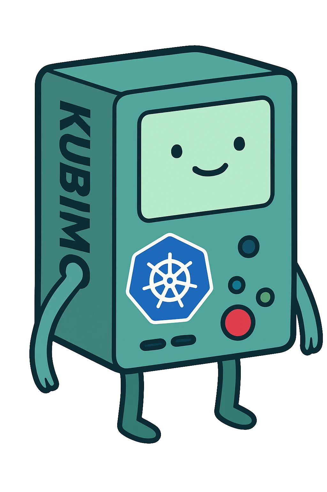

<p align="center">
  
  <h1 align="center">kubimo</h1>
</p>

## Example

Make sure to have [minikube installed and running](https://minikube.sigs.k8s.io/docs/start)

To run the controller first setup your environment. Example .envrc:

```bash
export RUST_LOG=info
export KUBIMO__RUNNER_STATUS__RESOLUTION__METHOD="Ingress"
export KUBIMO__RUNNER_STATUS__RESOLUTION__HOST="http://$(minikube ip):31439"
export KUBIMO__INGRESS_ENABLED=false                  # route runners with Gateway API only
export KUBIMO__GATEWAY__NAME=kubimo                   # the Gateway setup-minikube.sh creates
export KUBIMO__GATEWAY__NAMESPACE=envoy-gateway-system
export BUILDX_BAKE_FILE="docker-bake.hcl:docker-bake.dev.hcl"
export KUBIMO__MARIMO_IMAGE="ghcr.io/aqora-io/kubimo-marimo:dev"
export KUBIMO__AGENT_IMAGE="ghcr.io/aqora-io/kubimo-agent:dev"
```

Then setup minikube

```bash
scripts/setup-minikube-dev # setup minikube, Envoy Gateway, MinIO and the node agent
docker buildx bake marimo agent # build marimo and agent images
minikube image load ghcr.io/aqora-io/kubimo-marimo:dev # load images into minikube
minikube image load ghcr.io/aqora-io/kubimo-agent:dev
```

And finally run the controller

```bash
cargo run -p kubimo --example apply_crds # apply CRDs
cargo run # run controller
```

To create an example runner run

```bash
kubectl apply -f examples/basic.yaml
```

You should be able to access it soon with `$(minikube ip):31439/workspace/edit`

## Routing: Ingress vs Gateway API

Each runner, and each warm pod, is served under its own path prefix. The
controller routes it with an Ingress, a Gateway API `HTTPRoute`, or both:

| `controller.ingressEnabled` | `controller.gateway` | Routes written |
| --- | --- | --- |
| `true` (default) | unset (default) | Ingress |
| `true` | set | Ingress and HTTPRoute ("dual") |
| `false` | set | HTTPRoute; the Ingresses the controller wrote are deleted |
| `false` | unset | refused, by the chart render and at controller startup |

The controller reads them as `KUBIMO__INGRESS_ENABLED` and
`KUBIMO__GATEWAY__NAME`, `__NAMESPACE` and `__SECTION_NAME` (the listener to
attach to; unset attaches to all of them). The Gateway, its GatewayClass and
the Gateway API CRDs are not part of this chart; `scripts/setup-minikube.sh`
installs Envoy Gateway for local development.

An HTTPRoute mirrors the Ingress: same name, owner, hosts (`runnerHosts` plus a
runner's `spec.ingress.tls.hosts`) and path prefix, to the same Service. Its
request timeout is disabled (`0s`), and idle timeouts belong to the Gateway's
traffic policies: give streams at least the idle time `runnerProxyTimeoutSecs`
gives ingress-nginx, or a kernel websocket that is silent while a cell runs is
cut. `spec.ingress.className`, `tls.clusterIssuer` and `tls.secretName` only
shape the Ingress (the Gateway's listeners own TLS); `tls.hosts` adds hostnames
to both. The request timeout needs the Gateway API CRDs at v1.2 or later
(standard channel): older ones have no `timeouts` field, and the API server
rejects every HTTPRoute the controller applies.

Unsetting `controller.gateway` stops new HTTPRoutes but does not delete the
ones already written: they stay attached to the Gateway until their runner or
warm pod goes. Remove the Gateway too, or delete them.

To move a cluster from ingress-nginx to a Gateway:

1. Install the Gateway, with its listeners and certificate, beside
   ingress-nginx.
2. Set `controller.gateway` and leave Ingresses on (dual). Every runner, warm
   pod and the static-assets origin gets an HTTPRoute; warm pods are not
   re-minted.
3. Test against the Gateway's address directly (`curl --resolve
   <host>:443:<gateway-ip> ...`), then point the runner host's DNS at it.
   Pointing it back is the rollback.
4. Once ingress-nginx serves no traffic, set `controller.ingressEnabled: false`.
   The controller deletes runner and claimed-pod Ingresses, warm pods minted
   with an Ingress retire and re-mint without one, and the chart stops
   rendering the static-assets Ingress. A runner whose reconcile fails before
   its routes keeps its Ingress; check `kubectl get ingress -A`.
5. Remove ingress-nginx.

## Upgrading from 0.2.x

The chart runs the controller Deployment with the `Recreate` strategy, so two
controllers never reconcile side by side during a rollout. Applied server-side
(Argo CD with `ServerSideApply=true`, or helm 4 with `--server-side=true`; its
default, `auto`, keeps the method the previous release was applied with), the
upgrade of a release installed with the default `RollingUpdate` is refused: the
API server filled in `spec.strategy.rollingUpdate`, no field manager owns it to
remove it, and it is forbidden beside `Recreate`. A refused upgrade leaves the
new CRDs and agent running beside the old controller, so switch the strategy
once, before upgrading. It does not restart the controller:

```bash
kubectl -n <namespace> patch deployment <deployment> --type=json \
  -p '[{"op":"replace","path":"/spec/strategy","value":{"type":"Recreate"}}]'
```

`<deployment>` is the controller Deployment the release created, which
`kubectl -n <namespace> get deployments` lists.
